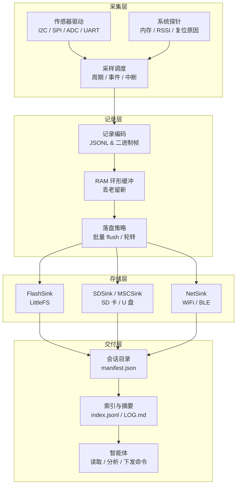
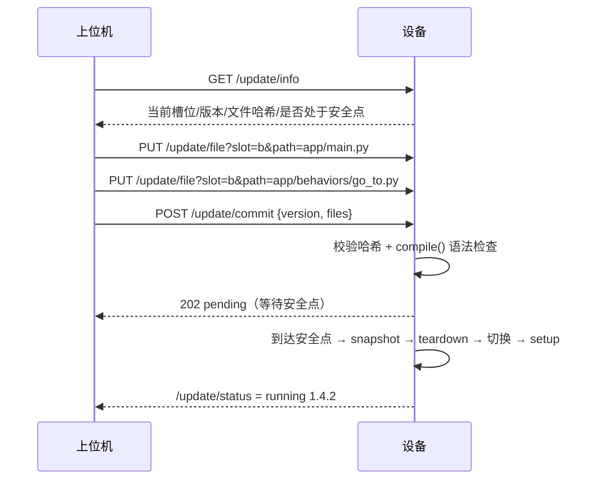

# MicroPython 调试日志采集系统 · 设计方案

> 版本：v1.1  
> 适用范围：机器人 / 嵌入式设备的调试、行为解释与在线迭代；也适用于老化测试与现场问题复现  
> 目标平台：ESP32 / ESP32-S3 / ESP8266 / RP2040 / RP2350 / STM32 / SAMD / nRF 等具备 `machine` 模块的 MCU

---

## 1. 概述

### 1.1 要解决的问题

嵌入式设备出问题时，通常只能看到串口打印，缺少：

- 结构化、可回溯的历史数据；
- 掉电后仍然保留的现场；
- 能被人和智能体直接理解的数据格式；
- 不依赖调试线缆的取数方式；
- 机器人做决策时的依据，事后只能靠猜；
- 改一行逻辑就要重新编译、烧录的迭代效率。

本方案构建一套「采集 → 缓冲 → 落盘 → 交付」的调试日志系统：各类传感器与系统探针的数据统一编码为结构化日志，写入 Flash / SD 卡 / U 盘，或经 WiFi / BLE 送到主机；最终以一个**自包含的会话目录**交付给智能体分析。

在此基础上再往上走一层：系统同时承担机器人的**解释层**（记录意图、候选方案、选择理由与预期/实测差异，支持 `/why` 追问），并提供**免编译热更新**（上位机直接下发 `.py` 应用，设备在安全点切换，失败自动回滚）。

### 1.2 设计目标

| 目标 | 说明 |
| --- | --- |
| 结构化 | 每条记录自描述，带来源、时间、级别、单位语义 |
| 掉电安全 | 追加写 + 截断恢复，断电最多丢最后一个 flush 周期 |
| 介质无关 | 存储后端可插拔，SD 卡拔出不影响系统继续运行 |
| 低侵入 | 采样端只入内存队列，不阻塞中断与业务逻辑 |
| 智能体友好 | 会话目录内含机器可读元数据与自然语言说明书 |
| 可双向 | 支持主机下发命令，实现「看日志 → 改参数 → 复采」闭环 |
| 自解释 | 不只记录「发生了什么」，还记录「为什么这么做」，可回答上位机的追问 |
| 免编译更新 | 上位机直接下发 `.py` 源码，设备导入即生效，无需 mpy-cross 或固件编译 |

### 1.3 非目标

- 不做逻辑分析仪级别的高速采样（> 1 kHz 连续流）；
- 不做固件级 OTA：MicroPython 内核与 C 模块的更新仍需烧录，本方案的热更新只覆盖 Python 应用层；
- 不替代 `printf` 式即时调试，二者互补；
- 不在设备端做复杂数据分析，聚合与推理放在主机侧。

---

## 2. 总体架构



### 2.1 分层职责

| 层 | 职责 | 不做什么 |
| --- | --- | --- |
| 采集层 | 读取传感器、统一单位、标注质量位 | 不写文件、不做格式化 |
| 记录层 | 编码、缓冲、批量刷盘、文件轮转 | 不关心介质类型 |
| 存储层 | 打开/写入/同步/关闭具体介质 | 不解析日志内容 |
| 交付层 | 组织会话目录、生成索引与摘要、暴露接口 | 不做实时采样 |

### 2.2 数据流

1. 采样任务按配置周期触发，读取传感器并调用 `emit()`；
2. `emit()` 生成一条记录，写入 RAM 环形缓冲，立即返回；
3. Writer 任务批量取出记录，编码后写入所有已启用的 Sink；
4. Sink 按自身策略 flush（时间或字节阈值）；
5. 会话结束时补写 `manifest.json` 的 `close` 字段并生成 `LOG.md`。

生产与消费彻底解耦：任何一个 Sink 变慢或失败，都不会反压到采样中断。

### 2.3 两条横切能力

解释层与更新层不单独占一层，而是横跨整条链路：

- **解释层**：消费记录流与行为契约，产出 `EXPLAIN.md`，并通过 `/why` 回答上位机追问。它不改变采集与存储，只增加 L1 决策信息。
- **更新层**：管理 `app_a` / `app_b` 两个应用槽位，与日志系统解耦。更新只替换 `app/`，`kernel/` 保持稳定，正在写入的会话不受影响。

换一种说法：采集层负责“感知”，解释层负责“说出理由”，更新层负责“换一套行为”。三者共用同一套记录格式，因此智能体看到的永远是同一种文档。

---

## 3. 日志数据模型

### 3.1 主通道格式：JSONL

主日志流 `events.jsonl` 每行一条独立 JSON，UTF-8 编码，以 `\n` 结尾。

```json
{"v":1,"seq":10231,"t":84213,"ts":1760000000,"src":"bmp280","lvl":"INFO","ev":"sample","m":{"p":1003.2,"tc":24.6},"q":"ok"}
```

**为什么选 JSONL 而不是 CSV / 纯二进制：**

- 追加写天然安全，单行损坏不影响其它行；
- 人和 LLM 可直接阅读，新增字段不会破坏旧解析器；
- 支持流式处理，主机可以边下边解析；
- 压缩后可读性依旧保留（gzip 后智能体仍能解压读取）。

代价是体积约为二进制的 2~4 倍，因此高频数据分流到二进制通道。

### 3.2 字段定义

| 字段 | 类型 | 必填 | 说明 |
| --- | --- | --- | --- |
| `v` | int | 是 | schema 版本，当前为 `1` |
| `seq` | int | 是 | 会话内自增序号，从 1 开始，用于定位与缺口检测 |
| `t` | int | 是 | 开机后毫秒数，来自 `time.ticks_ms()`，比较时使用 `ticks_diff` |
| `ts` | int/null | 是 | 绝对时间（epoch 秒）；无 RTC 且未校时时为 `null` |
| `src` | string | 是 | 数据源标识，如 `bmp280`、`sys`、`wifi`、`app` |
| `lvl` | string | 是 | `DEBUG` / `INFO` / `WARN` / `ERROR` / `CRIT` |
| `ev` | string | 是 | 事件类型，见下表 |
| `m` | object | 否 | 测量值字典，键为短名，单位在 `README.md` 中声明 |
| `q` | string | 否 | 质量位：`ok` / `timeout` / `range` / `crc` / `stale` |
| `ctx` | object | 否 | 上下文：`task`、`func`、`line`、`boot` |
| `cid` | string | 否 | 因果链 ID，同一次决策的 intent / plan / action / outcome 共用一个值 |
| `ref` | int | 否 | 指向上一条相关记录的 `seq`，用于回溯 |
| `why` | string | 否 | 人类可读的简短理由，进入解释层的原始素材 |
| `crc` | string | 否 | 可选，记录级 CRC32（默认关闭，见 3.5） |

### 3.3 事件类型

| `ev` | 触发时机 | 典型字段 |
| --- | --- | --- |
| `boot` | 每次启动 | `reset_cause`、`fw`、`free_mem` |
| `sample` | 周期采样 | `m` 测量值 |
| `error` | 驱动或总线异常 | `code`、`detail` |
| `degrade` | 存储/网络降级 | `from`、`to`、`reason` |
| `drop` | 环形缓冲溢出 | `count`、`first_seq` |
| `cmd` | 收到主机命令 | `cmd`、`result` |
| `mark` | 用户埋点 | `label` |
| `intent` | 产生一个目标 | `goal`、`args`、`why` |
| `plan` | 选定方案 | `chosen`、`rejected` |
| `action` | 开始执行动作 | `act`、`expect` |
| `outcome` | 动作结束 | `ok`、`observed`、`ref` |
| `state` | 状态机迁移 | `from`、`to`、`trigger` |
| `assert` | 断言/安全检查 | `cond`、`ok`、`detail` |
| `close` | 会话结束 | `reason` |

### 3.4 记录示例

```json
{"v":1,"seq":1,"t":312,"ts":1760000000,"src":"sys","lvl":"INFO","ev":"boot","m":{"reset":"power_on","fw":"1.29.0","free":182304}}
{"v":1,"seq":2,"t":420,"ts":null,"src":"bmp280","lvl":"INFO","ev":"sample","m":{"p":1003.2,"tc":24.6},"q":"ok"}
{"v":1,"seq":3,"t":1520,"ts":null,"src":"bmp280","lvl":"ERROR","ev":"error","m":{"code":"ETIMEDOUT","addr":"0x76"},"q":"timeout"}
{"v":1,"seq":4,"t":1600,"ts":null,"src":"sd","lvl":"WARN","ev":"degrade","m":{"from":"sd","to":"flash","reason":"EIO"}}
```

### 3.5 完整性与校验

**主通道（JSONL）默认不逐行写 CRC**，理由：JSON 语法本身即可发现截断与损坏，且逐行 CRC 会破坏「智能体直读」。用以下三重机制保证完整性：

1. **行完整性**：最后一行若无换行符或 JSON 解析失败，直接丢弃；
2. **序号连续性**：`seq` 出现跳变即说明丢记录，在恢复报告中标注缺口；
3. **会话闭合**：`manifest.close` 存在表示正常关闭，缺失则为异常掉电。

**二进制通道（`raw/`）必须逐帧带 CRC**：帧头 `0xAA55` + `len`(2B) + `seq`(4B) + `crc32`(4B) + payload。解码时 `crc32` 失败即整帧丢弃。

若某场景必须对 JSONL 做强校验，可在配置中开启 `log.record_crc=true`：设备在序列化完成后追加 `"crc":"xxxxxxxx"` 字段，CRC 覆盖追加该字段之前的整行字节。

---

## 4. 会话目录规范

一次上电运行对应一个会话，目录名格式 `S<YYYYMMDD>-<HHMMSS>`；无 RTC 时退化为 `S<boot_id>-<ticks>`。

会话内允许发生应用热更新：不重建目录，只写一条 `ev=reload` 记录新旧版本，`manifest.app.version` 保留起始版本。智能体按 `reload` 记录把会话切成若干“行为段”，用于对比版本差异。

```text
/LOG/
├── LATEST                          # 单行文本，指向最近会话目录名
├── S20261016-142530/
│   ├── manifest.json               # 机器可读元数据
│   ├── robot.json                  # 本会话生效的自描述快照（能力/策略/版本）
│   ├── README.md                   # 给智能体的字段说明书
│   ├── LOG.md                      # 自动生成的人类/智能体摘要
│   ├── EXPLAIN.md                  # 行为解释：决策链、失败归因、信息缺口
│   ├── index.jsonl                 # 每 N 条一行的跳表索引
│   ├── events.jsonl                # 主日志流（append-only）
│   └── raw/
│       ├── imu-0001.bin            # 高频二进制块
│       └── imu-0001.idx            # 块索引：起始 seq / 时间 / 条数
└── _trash/                         # 轮转淘汰的旧会话
```

### 4.1 manifest.json

```json
{
  "v": 1,
  "session": "S20261016-142530",
  "device": {
    "port": "esp32",
    "board": "ESP32-S3-DevKitC",
    "fw": "1.29.0",
    "id": "A1B2C3D4"
  },
  "app": {"version": "1.4.2", "slot": "a"},
  "clock": {
    "mode": "rtc",
    "t0_epoch": 1760000000,
    "t0_ticks": 0,
    "rtc": "ds3231",
    "drift_ppm": null
  },
  "buses": {
    "i2c0": {"scl": 22, "sda": 21, "freq": 400000}
  },
  "sensors": [
    {"id": "bmp280", "bus": "i2c0", "addr": "0x76", "hz": 1, "fields": {"p": "hPa", "tc": "degC"}},
    {"id": "lsm6dso", "bus": "i2c0", "addr": "0x6A", "hz": 50, "channels": "raw"}
  ],
  "files": {
    "events": "events.jsonl",
    "index": "index.jsonl",
    "summary": "LOG.md",
    "explain": "EXPLAIN.md",
    "robot": "robot.json"
  },
  "limits": {
    "max_bytes": 2097152,
    "rotate_bytes": 524288,
    "flush_ms": 1000,
    "ring_bytes": 16384
  },
  "close": null
}
```

`manifest.json` 必须采用「写临时文件 → rename 覆盖」的方式更新，避免掉电产生半截 JSON。

### 4.2 index.jsonl

每 100 条记录写一行索引，用于快速定位：

```json
{"seq":100,"off":18342,"t":84100,"lvl":"INFO"}
{"seq":200,"off":36811,"t":168300,"lvl":"INFO"}
```

`off` 为该 `seq` 记录在 `events.jsonl` 中的字节偏移，可由 `f.tell()` 获取。

### 4.3 LOG.md

会话结束时（或每 N 分钟增量更新）在设备端生成，也可由主机侧生成。内容控制在几百行内：

```markdown
# 会话 S20261016-142530

- 设备：ESP32-S3 / MicroPython 1.29.0
- 时长：00:12:41
- 记录：761 条，其中 WARN 12 条、ERROR 3 条
- 结束：异常掉电（无 close 记录）
- 结论：bmp280 自 14:31:02 起出现 37 次 I2C 超时，疑似接线松动

## 时间线

| 时间 | 事件 | 说明 |
| --- | --- | --- |
| 14:25:30 | boot | power_on，free=182304 |
| 14:31:02 | error | bmp280 ETIMEDOUT ×1 |
| 14:31:04 | degrade | sd → flash，EIO |

## 缺口

- seq 320-328 缺失（环形缓冲溢出 9 条）
```

### 4.4 README.md（智能体说明书）

这是整个方案里最容易被忽略、但对智能体最关键的文件。模板：

```markdown
# 如何读取本会话

## 快速开始
1. 读 `manifest.json`，获取时钟基准、传感器清单、采样率与文件映射；
2. 问题与行为有关时，先读 `EXPLAIN.md` 的关键决策与失败归因，再读 `robot.json` 的能力与安全策略；
3. 读 `events.jsonl`，每行一条 JSON，按 `seq` 递增；
4. 需要定位时先查 `index.jsonl` 的字节偏移，再 seek；
5. 追问“为什么”时，沿同一条 `cid` 或 `ref` 链回溯 `intent → plan → action → outcome`。

## 字段
- `t` 是开机毫秒，用 `ts = t0_epoch + t/1000` 换算绝对时间（`t0_epoch` 为 null 时不可换算）；
- `lvl` 顺序：DEBUG < INFO < WARN < ERROR < CRIT；
- `q != "ok"` 表示该测量值不可信，不要参与趋势分析；
- `cid` 标识一次决策，`ref` 指向上一条相关记录，`why` 是简短理由；
- 找不到 `ref` 或对应 `ev` 时，说明该环节未埋点，请直接标注“未知”，不要推测。

## 常用查询
- 所有错误：`jq 'select(.lvl=="ERROR" or .lvl=="CRIT")' events.jsonl`
- 某传感器：`jq 'select(.src=="bmp280")' events.jsonl`
- 时间窗：`jq 'select(.t>=60000 and .t<120000)' events.jsonl`
- 一次决策的完整链：`jq 'select(.cid=="c7")' events.jsonl`

## 注意
- 末尾无换行的一行可能被截断，请忽略；
- `seq` 跳变代表丢数据，不要假设等间隔。
```

---

## 5. 模块设计

### 5.1 目录结构（设备端）

内核（`kernel/`）与应用（`app_a/` / `app_b/`）分离，更新只替换应用槽位：

```text
/
├── boot.py                # 挂载文件系统、读 current.json、选择应用槽位
├── current.json           # 当前槽位与版本
├── bootcnt                # 启动失败计数
├── kernel/                # 稳定层，随固件发布
│   ├── main.py            # 装配：总线、传感器、Sink、writer、调度
│   ├── config.json        # 设备与采样配置
│   ├── logcore/
│   │   ├── record.py      # 记录编码与字段校验
│   │   ├── ring.py        # RAM 环形缓冲
│   │   ├── writer.py      # 批量取数、刷盘、轮转
│   │   ├── session.py     # 会话目录、manifest、恢复扫描
│   │   └── summary.py     # LOG.md / EXPLAIN.md 生成
│   ├── sinks/
│   │   ├── base.py        # Sink 抽象
│   │   ├── flash.py       # LittleFS
│   │   ├── sd.py          # SD 卡
│   │   ├── msc.py         # U 盘 / USB MSC
│   │   └── net.py         # HTTP / MQTT / BLE
│   ├── probes/
│   │   ├── base.py        # Probe 抽象
│   │   ├── bmp280.py      # 适配现有驱动
│   │   ├── lsm6dso.py
│   │   └── sysinfo.py     # 内存、RSSI、复位原因
│   ├── agentsrv/
│   │   ├── http.py        # 只读 API + /why + /update
│   │   └── ctl.py         # 命令轮询
│   └── updater.py         # 槽位校验、切换、回滚
├── app_a/                 # 应用槽位 A
│   ├── main.py            # setup / step / teardown / snapshot
│   ├── behaviors/         # 行为契约与实现
│   ├── policies/          # 安全策略
│   └── params.json
└── app_b/                 # 应用槽位 B
```

### 5.2 配置示例

```json
{
  "device": {"name": "bench-01"},
  "log": {
    "root": "/LOG",
    "flush_ms": 1000,
    "rotate_bytes": 524288,
    "keep_sessions": 8,
    "ring_bytes": 16384,
    "min_level": "DEBUG"
  },
  "sinks": [
    {"type": "flash", "path": "/LOG", "enabled": true},
    {"type": "sd", "sck": 18, "mosi": 23, "miso": 19, "cs": 5, "enabled": true},
    {"type": "net", "proto": "http", "enabled": false}
  ],
  "sensors": [
    {"id": "bmp280", "driver": "bmp280", "bus": "i2c0", "addr": 118, "hz": 1},
    {"id": "lsm6dso", "driver": "LSM6DSO", "bus": "i2c0", "addr": 106, "hz": 50, "channel": "raw"}
  ]
}
```

### 5.3 Probe 抽象（对接现有驱动）

仓库中已有 `sensor/` 与 `misc/` 下的驱动可直接复用，只需包一层统一接口：

```python
class Probe:
    src = "probe"
    def init(self): ...
    def read(self) -> dict: ...   # 返回 {"字段": 值}，单位与 manifest 一致
    def hz(self) -> float: ...
```

适配示例（属性名以各驱动 README 为准）：

```python
# probes/bmp280.py
from bmp280 import BMP280

class Bmp280Probe:
    src = "bmp280"
    def __init__(self, i2c, addr=0x76, hz=1):
        self.dev = BMP280(i2c, addr)
        self._hz = hz

    def read(self):
        try:
            return {"p": self.dev.pressure, "tc": self.dev.temperature}
        except OSError:
            return None          # 由调度器写入 error 记录

    def hz(self):
        return self._hz
```

可复用的驱动清单：

| 类型 | 驱动路径 |
| --- | --- |
| 气压/温湿度 | `sensor/bmp180/BMP180.py`、`sensor/bmp280/bmp280.py`、`sensor/bme280/bme280.py` |
| 温湿度/气压 | `sensor/HTS221/hts221.py`、`sensor/LPS22/LPS22.py`、`sensor/STTS751/STTS751.py` |
| IMU | `sensor/LSM6DSO/LSM6DSO.py`、`sensor/LIS2DW12/LIS2DW12.py`、`sensor/LIS2MDL/LIS2MDL.py` |
| 光/接近 | `sensor/APDS9930/APDS9930.py` |
| RTC | `misc/DS3231/DS3231.py`、`misc/DS1307/DS1307.py`、`misc/DS1302/DS1302.py` |
| EEPROM | `misc/AT24XX/AT24XX.py`（可存配置或掉电计数） |

### 5.4 记录层

```python
# logcore/record.py
import time, json

_seq = 0

def emit(src, lvl="INFO", ev="sample", m=None, q="ok", ctx=None):
    global _seq
    _seq += 1
    rec = {
        "v": 1,
        "seq": _seq,
        "t": time.ticks_ms(),
        "ts": _epoch_or_none(),
        "src": src,
        "lvl": lvl,
        "ev": ev,
    }
    if m:
        rec["m"] = m
    if q != "ok":
        rec["q"] = q
    if ctx:
        rec["ctx"] = ctx
    ring.push(json.dumps(rec).encode() + b"\n")
```

高频通道绕过 `json.dumps`，直接 `struct.pack`：

```python
# 每条 IMU 样本 16 字节：t(4) + ax/ay/az/gx/gy/gz (6×2, int16)
def emit_raw(seq, t, samples):
    payload = b"".join(struct.pack("<Ihhhhhh", t, *s) for s in samples)
    raw_writer.append(seq, t, payload)
```

### 5.5 存储抽象

```python
class Sink:
    name = "sink"

    def open(self, session_dir): ...
    def write(self, buf): ...
    def sync(self): ...
    def rotate(self, reason="size"): ...
    def close(self, reason="normal"): ...
    def info(self): return {"name": self.name, "healthy": True}
```

`SinkRouter` 负责：

- 按 `config.sinks` 顺序打开，失败的跳过并记录 `degrade`；
- `write` 时逐个投递，单个 Sink 抛 `OSError` 只标记不可用，不影响其它 Sink；
- 周期性健康检查（如 SD 卡是否仍可写），恢复后重新接入并补写 `degrade` 恢复记录；
- 所有 Sink 都不可用时降级为 `NullSink`，仅保留 RAM 环形缓冲与串口输出。

### 5.6 Writer 任务

```python
class Writer:
    def __init__(self, router, flush_ms=1000, rotate_bytes=524288):
        self.router = router
        self.flush_ms = flush_ms
        self.rotate_bytes = rotate_bytes
        self.last_flush = time.ticks_ms()
        self.written = 0

    def run(self):
        while True:
            batch = ring.pop_batch(4096)
            if batch:
                self.router.write(batch)
                self.written += len(batch)
            now = time.ticks_ms()
            if time.ticks_diff(now, self.last_flush) >= self.flush_ms:
                self.router.sync()
                self.last_flush = now
            if self.written >= self.rotate_bytes:
                self.router.rotate("size")
                self.written = 0
            time.sleep_ms(20)
```

`Writer.run()` 放在主循环或 `asyncio` 任务中执行，**绝不在定时器/中断回调中调用**。

### 5.7 采样调度

- 低频（≤ 10 Hz）：主循环轮询，读取 `ticks_diff` 判断是否到期；
- 中频（10~100 Hz）：`machine.Timer` 回调中只置标志或写环形缓冲，不做 I2C 读；
- 高频（> 100 Hz）：使用传感器内置 FIFO + 中断（如 LSM6DSO 的 FIFO/INT），中断中只读 FIFO 到本地数组，主循环批量打包。

所有 I2C/SPI 读操作都在主上下文完成，避免在中断里发生总线阻塞。

---

## 6. 传输与智能体交互

### 6.1 三种取数模式

| 模式 | 链路 | 适用场景 | 优点 | 缺点 |
| --- | --- | --- | --- | --- |
| 介质摆渡 | SD 卡 / U 盘 | 长时间无人值守 | 容量大、零功耗、最稳 | 需人工拔插 |
| 主动拉取 | WiFi HTTP | 台架调试、现场排障 | 断点续传、可脚本化 | 需要网络与 IP |
| 实时推送 | WiFi MQTT / BLE | 告警、在线观察 | 低延迟 | 易丢数据、功耗高 |

推荐默认组合：**SD 卡常开记录 + WiFi 按需开启拉取 + BLE/MQTT 只推 `ERROR/CRIT`**。

### 6.2 HTTP 接口

设备端运行一个极小 HTTP 服务（`asyncio.start_server` 或 `socket`），只读为主：

| 方法 | 路径 | 说明 |
| --- | --- | --- |
| GET | `/sessions` | 会话列表及大小 |
| GET | `/manifest?session=` | 返回 manifest.json |
| GET | `/tail?session=&n=100` | 返回最后 N 条记录 |
| GET | `/range?session=&from=&limit=500` | 按 seq 区间取记录 |
| GET | `/file?session=&path=events.jsonl` | 下载文件，支持 `Range` |
| GET | `/health` | 内存、介质状态、最后 seq |
| POST | `/ctl` | 下发命令（需 token） |

`/file` 支持 `Range: bytes=18342-`，配合 `index.jsonl` 即可实现断点续传。

### 6.3 BLE 接口

BLE 仅承载小数据量：

| 特征 | 属性 | 用途 |
| --- | --- | --- |
| `manifest` | Read | 读取设备与会话元数据 |
| `tail` | Read / Notify | 最近 N 条摘要或告警 |
| `cmd` | Write | 下发短命令（改采样率、立即 flush、打标） |
| `chunk` | Read | 分块读取文件（每块 ≤ MTU-3） |

BLE 实测吞吐通常只有 5~20 KB/s，不适合传完整 `events.jsonl`；建议只传 `LOG.md` 与错误记录。

### 6.4 双向命令通道

文件摆渡与 HTTP 共用同一套命令格式：

```json
// /CTL/cmd.json
{"seq": 12, "cmd": "set_rate", "src": "bmp280", "hz": 4, "ttl_s": 60}
```

```json
// /CTL/ack.json
{"seq": 12, "ok": true, "applied": {"src": "bmp280", "hz": 4}, "t": 84213}
```

支持的命令：

| `cmd` | 参数 | 作用 |
| --- | --- | --- |
| `set_rate` | `src`, `hz` | 修改采样率 |
| `flush` | — | 立即刷盘 |
| `mark` | `label` | 写入一条埋点记录 |
| `set_level` | `level` | 调整日志级别 |
| `rotate` | — | 强制轮转 |
| `dump` | `src`, `n` | 回传最近 N 条该源记录 |
| `set_time` | `epoch` | 校准绝对时间基准 |
| `reboot` | `delay_s` | 延时重启（谨慎启用） |

命令必须带 `seq` 去重、带 `ttl_s` 过期，且只允许白名单命令。

### 6.5 智能体接入方式

1. **离线直读**：主机挂载 SD/U 盘或拷贝会话目录，智能体直接读 `README.md` → `manifest.json` → `LOG.md` → `events.jsonl`；
2. **MCP / 工具封装**：把 `/range`、`/tail`、`/ctl` 封装成主机侧工具，智能体按需查询，不必下载整份日志；
3. **混合**：先读 `LOG.md` 定位时间窗，再用 `/range` 精确拉取。

Prompt 约定（建议写进 `README.md`）：

> 你是硬件调试助手。先读 `manifest.json` 确认时钟与传感器，再读 `LOG.md` 获取结论，最后用 `events.jsonl` 验证。分析结论必须引用具体 `seq`，区分「测量值异常」与「采集链路异常」。

---

## 7. 机器人解释层

### 7.1 从「记录数据」到「解释行为」

普通日志回答“传感器读到了什么”；解释层要回答另外三个问题：

- 机器人现在在做什么？（状态与意图）
- 为什么这么做？（决策依据与被否决的方案）
- 做完之后实际发生了什么？（预期与实测的差异）

对应三层信息：

| 层级 | 内容 | 来源 | 输出 |
| --- | --- | --- | --- |
| L0 事实层 | 传感器值、执行器输出、系统资源 | Probe | `events.jsonl` |
| L1 决策层 | 目标、候选方案、选择理由、预期结果 | 应用代码主动埋点 | `events.jsonl` 中的 `intent/plan/action/outcome` |
| L2 叙事层 | 会话摘要、因果链、失败归因 | 设备或主机聚合 | `LOG.md` / `EXPLAIN.md` |

关键约束：**L1 必须由运行中的应用主动上报**。事后从 L0 反推出来的“理由”只是猜测，不能当作解释。行为代码里少写一行 `emit`，解释层就少一个环节，因此埋点覆盖率要作为一项指标。

### 7.2 自描述：robot.json

设备启动时生成或读取一份自描述文件，与 `manifest.json` 并列存放。它既是智能体的入口，也是运行时校验行为合法性的依据：

```json
{
  "id": "r1",
  "model": "diff-drive-01",
  "firmware": {"kernel": "1.0.0", "app": "1.4.2"},
  "states": ["IDLE", "NAV", "GRASP", "FAULT"],
  "capabilities": [
    {"id": "go_to", "args": {"x": "m", "y": "m"}, "limits": {"max_speed": 0.3}},
    {"id": "grab", "args": {"target": "str"}, "limits": {"max_force": 20}}
  ],
  "sensors": ["bmp280", "lsm6dso", "tof_left", "tof_right"],
  "actuators": ["wheel_l", "wheel_r", "gripper"],
  "safety": {"estop_pin": 4, "max_tilt": 25, "min_battery": 20},
  "policies": [
    {"id": "avoid", "priority": 10, "when": "tof < 0.25", "then": "stop"},
    {"id": "failsafe", "priority": 20, "when": "battery < 20", "then": "return_home"}
  ],
  "entry": "app.main"
}
```

`capabilities` 与 `policies` 是给智能体看的“能做什么、受什么限制”，也是应用更新时的兼容性约束：新版本不能声明旧内核不支持的能力。

### 7.3 行为契约

每个行为模块导出一份契约，运行时在执行前后自动校验并记录：

```python
# app/behaviors/go_to.py
BEHAVIOR = {
    "id": "go_to",
    "pre": ["battery > 20", "localized"],
    "abort": ["tof < 0.2"],
    "effects": ["pose_changed"],
    "explain": "前往 ({x:.2f}, {y:.2f})，原因：{why}",
}

def run(ctx, x, y, why):
    ...
```

执行器统一入口：

```python
def invoke(behavior, args, why):
    cid = ctx.next_cid()
    emit("app", "INFO", "intent", {"goal": behavior["id"], "args": args},
         cid=cid, why=why)

    failed = [p for p in behavior["pre"] if not ctx.check(p)]
    if failed:
        emit("app", "WARN", "assert",
             {"cond": failed, "ok": False, "detail": "precondition"},
             cid=cid, ref=ctx.last_seq())
        return False

    emit("app", "INFO", "action",
         {"act": behavior["id"], "args": args, "expect": behavior["effects"]},
         cid=cid)

    ok, observed = behavior["run"](ctx, **args)
    emit("app", "INFO", "outcome",
         {"ok": ok, "observed": observed}, cid=cid, ref=ctx.last_seq())
    return ok
```

约定：`behavior["run"]` 只做动作，不写日志；日志由 `invoke` 统一产生，保证格式一致。

### 7.4 因果记录

同一次决策的四类记录共用一个 `cid`，并用 `ref` 指向前一条：

```json
{"v":1,"seq":41,"t":12000,"ts":null,"src":"app","lvl":"INFO","ev":"intent","cid":"c7","why":"task=patrol#3","m":{"goal":"go_to","x":1.2,"y":0.8}}
{"v":1,"seq":42,"t":12010,"ts":null,"src":"app","lvl":"INFO","ev":"plan","cid":"c7","ref":41,"m":{"chosen":"go_to","rejected":[{"alt":"arc","reason":"tof=0.18"}]}}
{"v":1,"seq":43,"t":12020,"ts":null,"src":"app","lvl":"INFO","ev":"action","cid":"c7","ref":42,"m":{"act":"go_to","expect":"arrive<3s"}}
{"v":1,"seq":44,"t":15020,"ts":null,"src":"app","lvl":"WARN","ev":"outcome","cid":"c7","ref":43,"m":{"ok":false,"observed":"stuck","dist":0.12}}
```

这段链路就是一次可解释的最小单元：**想做什么 → 为什么选它 → 怎么做的 → 结果如何**。

### 7.5 解释接口

| 方法 | 路径 | 返回 |
| --- | --- | --- |
| GET | `/state` | 当前状态、最后意图、活动故障、最近 5 条决策 |
| GET | `/why?seq=44` | 沿 `ref` 链回溯最多 5 跳，渲染成因果说明 |
| GET | `/timeline?from=&to=` | 按时间窗返回决策与状态迁移 |
| GET | `/capabilities` | 能力、限制、安全策略 |
| GET | `/explain?session=` | 生成整份 `EXPLAIN.md` |

`/why` 的返回同时给两种格式，方便人和模型使用：

```json
{
  "seq": 44,
  "chain": [44, 43, 42, 41],
  "text": "机器人在 t=12.0s 决定前往 (1.2, 0.8)，因为巡逻任务第 3 段；\n由于左侧测距 0.18m 低于安全阈值，放弃了弧线路径；\n执行 3 秒后仍未到达，距离 0.12m，判定为卡住。",
  "observed": {"ok": false, "dist": 0.12},
  "expect": "arrive<3s"
}
```

实现要点：只读 `events.jsonl` 即可，不需要额外存储；找不到 `ref` 时明确返回“该环节未埋点”，不要补写推测。

### 7.6 EXPLAIN.md

与会话目录放在一起，会话结束时生成，也可按需增量刷新：

```markdown
# 会话解释 S20261016-142530

## 任务
巡逻任务，共 3 段路径，目标为 (1.2, 0.8)。

## 关键决策
| 时间 | 决策 | 理由 | 结果 |
| --- | --- | --- | --- |
| 12.0s | 前往 (1.2,0.8) | 巡逻第 3 段 | 卡住 |
| 15.0s | 放弃弧线路径 | tof 0.18 < 0.25 | — |
| 15.2s | 进入 FAULT | 连续 2 次未到达 | 停机 |

## 失败归因
- 直接原因：路径被障碍物阻挡，tof 左 0.18m；
- 触发策略：`avoid`（优先级 10）；
- 未触发项：`failsafe` 电量正常；
- 缺口：`go_to` 内部的电机电流未埋点，无法判断是否打滑。
```

最后一行“缺口”很重要：明确告诉智能体哪些信息缺失，避免它用常识补全。

### 7.7 智能体问答闭环

| 用户问题 | 智能体动作 |
| --- | --- |
| “为什么刚才停下来了？” | `GET /why?seq=<最后一条 outcome>` → 读因果链 |
| “这次任务为什么失败？” | 读 `EXPLAIN.md` 的失败归因段落 |
| “能不能开快一点？” | 读 `/capabilities` 的 `max_speed`，再查 `policies` 是否冲突 |
| “改一下避障距离，再跑一次” | `POST /ctl` 改参数，或推送新版本 → 观察新会话 |
| “这个版本比上个版本差在哪？” | 按 `ev=reload` 切分会话，对比成功率与异常分布 |

### 7.8 解释的边界

- 解释的是**系统内部的理由**，不等于物理世界的真实因果。电机堵转可能被记录成“超时”，而不是“轮子被卡”。
- 必须同时记录 `expect` 与 `observed`，否则容易自圆其说。
- 未埋点的环节要显式标注为缺口，禁止让模型自行补全。
- 解释层不参与控制决策，只读不写，避免“为了让日志好看而改变行为”。

---

## 8. 免编译热更新

### 8.1 设计原则

1. **上位机只传 `.py` 源码**，设备导入时编译；不需要 mpy-cross，也不需要重新编译固件。
2. **内核与应用分离**：`kernel/` 稳定（调度、日志、驱动、更新器），`app/` 高频迭代（行为、策略、参数）。
3. **双槽位 + 指针切换**：新版本写入非活动槽，校验通过后才切换指针。
4. **安全点应用**：机器人运动、抓取、标定过程中不重载。
5. **失败自动回滚**：连续启动失败达到阈值，自动退回上一版本。

### 8.2 目录与槽位

```text
/
├── boot.py                 # 只负责挂载文件系统、读取 current.json、跳转到内核
├── kernel/
│   ├── main.py             # 调度器、日志系统、更新器
│   ├── logcore/
│   ├── drivers/
│   └── updater.py
├── app_a/                  # 应用槽位 A
│   ├── main.py
│   ├── behaviors/
│   └── params.json
├── app_b/                  # 应用槽位 B
├── STATE/
│   └── state.json          # 重载前的运行状态快照
├── current.json            # 当前槽位与版本
├── bootcnt                 # 启动失败计数
└── LOG/                    # 会话目录，与代码完全分离
```

```json
// current.json
{"slot": "a", "version": "1.4.2", "prev": "b", "confirmed": true, "kernel_min": "1.0.0"}
```

切换槽位只改 `current.json`，采用「写临时文件 → `os.rename` 覆盖」。日志目录与代码目录分离，更新不会触碰正在写入的会话。

### 8.3 更新包格式

```text
pkg-1.4.2/
├── update.json
└── app/
    ├── main.py
    ├── behaviors/
    │   ├── go_to.py
    │   └── grab.py
    └── params.json
```

```json
{
  "version": "1.4.2",
  "kernel_min": "1.0.0",
  "entry": "app.main",
  "note": "降低避障阈值，修复抓取超时",
  "files": [
    {"path": "app/main.py", "size": 4213, "sha256": "9f2c..."},
    {"path": "app/behaviors/go_to.py", "size": 2871, "sha256": "3ab1..."}
  ]
}
```

上位机在打包时计算哈希；设备逐文件校验。上传前先对比 `/update/info` 返回的哈希表，只传变化的文件，实现差分更新。

### 8.4 更新流程



| 步骤 | 接口 | 说明 |
| --- | --- | --- |
| 查询 | `GET /update/info` | 返回当前槽位、版本、各文件哈希、`safe` 标志 |
| 上传 | `PUT /update/file?slot=b&path=...` | 原始字节写入非活动槽，路径必须落在 `app_*` 内 |
| 提交 | `POST /update/commit` | 校验全部哈希与语法，写 `pending.json` |
| 应用 | `POST /update/apply` | 立即尝试应用；失败则保持 pending，等下一个安全点 |
| 状态 | `GET /update/status` | `idle / uploading / pending / applying / running / rolled_back` |
| 回滚 | `POST /update/rollback` | 手动切回 `prev` |

### 8.5 安全点与状态迁移

应用必须实现以下约定函数（`restore` 可选）：

```python
# app/main.py
def setup(ctx): ...          # 初始化行为、订阅配置
def step(dt_ms): ...         # 主循环调用，内部应快速返回
def teardown(): ...          # 释放资源、停止电机
def snapshot() -> dict: ...  # 导出需要跨版本保留的状态
def restore(state): ...      # 可选：从快照恢复任务队列与位姿
```

更新器只在满足以下条件时应用新版本：

- 状态机处于 `IDLE` 或显式声明的安全状态；
- 无运动指令、无抓取动作；
- 当前 `step()` 已返回，不在回调中；
- 电量高于阈值（避免切换过程中掉电）。

应用流程：

1. `state = snapshot()` 写入 `STATE/state.json`；
2. 调用旧版本 `teardown()`，确保执行器进入安全状态；
3. 切换 `current.json` 指针，重新导入 `app.*`；
4. 调用新版本 `setup(ctx)` 与 `restore(state)`；
5. 连续心跳 5 s 正常后写 `confirmed=true` 并清零 `bootcnt`；
6. 任一步抛异常 → 立即回滚并写 `CRIT`。

### 8.6 校验与约束

| 检查项 | 位置 | 规则 |
| --- | --- | --- |
| 语法 | 设备 | 逐文件 `compile(src, path, "exec")`，失败拒绝提交 |
| 语法（预检） | 上位机 | `ast.parse` 或 MicroPython unix 版导入测试，减少无效上传 |
| 哈希 | 设备 | `sha256` 流式计算；端口不支持时退化为 CRC32 并在 `update.json` 标注 |
| 大小 | 设备 | 单文件 ≤ 32 KB，整包 ≤ 256 KB（可按板型配置） |
| 路径 | 设备 | 只允许 `app_*` 前缀，拒绝 `..`、绝对路径、符号链接 |
| 内核兼容 | 设备 | `kernel_min` 必须 ≤ 当前内核版本 |
| 导入白名单 | 设备 | 应用只能导入 `machine`、`time`、`math`、`json`、`os`、`struct` 与 `app.*` |
| 命名 | 设备 | 入口模块必须存在且导出 `setup/step/teardown` |

设备端 `compile()` 会占用堆，大文件应在主机侧拆分为多个小模块；不建议在 ESP8266 等内存紧张的平台上一次性校验整包。

### 8.7 热重载骨架

```python
# kernel/updater.py
import sys, os, json

def _purge_app_modules():
    for name in [m for m in sys.modules
                 if m == "app" or m.startswith("app.")]:
        del sys.modules[name]

def load_app(slot, entry="app.main"):
    base = "/" + slot
    _purge_app_modules()
    if base in sys.path:
        sys.path.remove(base)
    sys.path.insert(0, base)          # 新槽位优先
    __import__(entry)
    return sys.modules[entry]

def apply(pending, ctx):
    if not ctx.safe_to_reload():
        return "pending"

    state = ctx.app.snapshot() if hasattr(ctx.app, "snapshot") else {}
    with open("/STATE/state.json", "w") as f:
        json.dump(state, f)

    try:
        ctx.app.teardown()
    except Exception as e:
        emit("sys", "ERROR", "reload", {"stage": "teardown", "err": str(e)})

    try:
        mod = load_app(pending["slot"], pending["entry"])
        mod.setup(ctx)
        if hasattr(mod, "restore"):
            mod.restore(state)
    except Exception as e:
        emit("sys", "CRIT", "reload", {"stage": "setup", "err": str(e)})
        rollback()
        return "rolled_back"

    switch_current(pending["slot"], pending["version"])
    emit("sys", "INFO", "reload",
         {"from": ctx.app_version, "to": pending["version"]})
    ctx.app, ctx.app_version = mod, pending["version"]
    return "running"
```

注意两点：

- 删除 `sys.modules` 中的旧模块只是让后续 `import` 拿到新代码，**已存在的对象引用不会自动更新**，所以必须走 `teardown → setup` 的完整重建；
- `sys.path` 中要移除旧槽位，避免同名模块被旧路径遮蔽。

### 8.8 上位机工具

```bash
logctl status --host 192.168.4.1
logctl push ./pkg-1.4.2 --host 192.168.4.1   # 计算哈希 + 差分上传 + 提交
logctl apply  --host 192.168.4.1             # 到安全点后应用
logctl rollback --host 192.168.4.1
logctl logs --tail 50 --host 192.168.4.1
```

`logctl push` 不做任何编译，只做三件事：计算哈希、上传差异文件、调用 commit。主机侧可选的 `ast.parse` 仅用于提前发现明显语法错误，不生成字节码。

### 8.9 回滚与失败模式

| 失败场景 | 检测方式 | 处理 |
| --- | --- | --- |
| 哈希不匹配 | commit 校验 | 拒绝提交，旧版本继续运行 |
| 语法错误 | `compile()` | 拒绝提交，返回具体文件与行号 |
| `setup()` 抛异常 | 应用钩子 | 切回 `prev`，写 `CRIT` |
| 启动后崩溃 | 心跳缺失 / 看门狗 | 重启，`bootcnt++`，达到 3 次回滚 |
| 新版本行为异常 | 主机看日志 | 手动 `logctl rollback`，保留现场会话 |
| 内核不兼容 | `kernel_min` | 提交阶段拒绝 |
| 更新中掉电 | 启动时检查 `pending.json` | 旧槽完整，`current.json` 未切换，直接走旧版本 |

`bootcnt` 的写入必须在 `boot.py` 早期完成，且用独立的单行文件，避免依赖完整 JSON 解析。

### 8.10 边界与注意事项

- 本方案只更新 Python 应用层；新增 C 模块、修改 MicroPython 内核仍需烧录固件。
- 更新期间日志继续写入当前会话，切换时写一条 `ev=reload` 作为分界；智能体据此按版本切分行为，对比新旧表现。
- 应用代码不要缓存跨版本的全局句柄（I2C、定时器、电机对象），统一由 `ctx` 提供，`setup` 时重新获取。
- 参数（`params.json`）与代码同包更新，避免“代码回滚了、参数没回滚”。
- 生产设备建议默认关闭 `/update/*` 写接口，仅在维护模式或本地 AP 下开启。

---

## 9. 可靠性设计

### 9.1 掉电恢复

启动时执行一次扫描：

```python
def recover(path):
    last_good = 0
    last_seq = 0
    with open(path, "rb+") as f:
        while True:
            line = f.readline()
            if not line:
                break
            if not line.endswith(b"\n"):
                break                      # 末尾截断，回退
            try:
                rec = json.loads(line)
            except ValueError:
                break                      # 损坏行，回退
            if rec["seq"] <= last_seq:
                break                      # 序号异常，回退
            last_seq = rec["seq"]
            last_good = f.tell()
        f.truncate(last_good)              # 截断到最后完整行
    return last_seq
```

恢复结果写入新会话的 `boot` 记录，包含：上一个会话名、恢复到的 `seq`、丢弃字节数。

### 9.2 时间同步

- 每条记录必须写 `t`（单调时钟），`ts` 可为空；
- 会话开始时由主机写入一次基准：`POST /ctl {"cmd":"set_time","epoch":...}`；
- 有 RTC 时每次写记录读取 RTC 成本过高，改为每 60 s 用 RTC 校正一次 `epoch = rtc + ticks_diff(now, base_ticks)/1000`；
- `ticks_ms()` 会回绕，所有差值必须用 `time.ticks_diff()`，禁止直接相减。

### 9.3 背压与丢弃

| 策略 | 行为 | 适用 |
| --- | --- | --- |
| `drop_oldest` | 覆盖最旧记录，累计 `dropped` | 默认，保证最新现场 |
| `drop_level` | 优先丢弃 `DEBUG`，再丢 `INFO` | 诊断期保留关键事件 |
| `block` | 生产者等待 | 仅用于非实时任务 |

丢弃后必须写一条 `ev=drop` 汇总记录（含 `count` 与 `first_seq`），否则分析时无法解释缺口。

### 9.4 介质降级

- SD 卡写入失败：标记 Sink 不可用，切到 Flash，写 `degrade` 记录；
- Flash 分区剩余 < 10%：删除 `_trash/` 中最旧会话；
- 所有介质满：只保留 RAM 环形缓冲，并通过 BLE/MQTT 发 `CRIT`；
- 网络断开：`NetSink` 进入重试队列，恢复后按 `seq` 续传，不重发已确认记录。

### 9.5 存储介质注意事项

| 介质 | 注意点 |
| --- | --- |
| 内置 Flash | 必须使用独立分区与 LittleFS；避免高频小写；轮转而非原地覆盖 |
| SD 卡 | 掉电可能损坏 FAT 目录项，建议每次会话结束显式 `sync` 并 `umount` |
| USB MSC | 主机挂载期间设备不能同时写同一分区，需明确「记录模式 / 导出模式」互斥 |
| U 盘 | 通过 USB OTG 主机模式挂载，需外部供电；插拔检测要做去抖 |

---

## 10. 资源与性能预算

以 ESP32-S3（约 300 KB 可用 heap）为例：

| 项目 | 预算 | 说明 |
| --- | --- | --- |
| RAM 环形缓冲 | 16 KB | 约 100 条 JSON 记录或 1000 条 IMU 样本 |
| 序列化缓冲 | 1 KB | 复用，避免 GC |
| Writer 批量缓冲 | 4 KB | 每次取数上限 |
| 协议栈 / Socket | 30~60 KB | 仅在 WiFi 开启时占用 |
| 单条 JSON 记录 | 120~200 B | 字段越多越大 |
| 写入吞吐 | 20~80 KB/s | Flash 与 SD 差异较大 |
| 典型日志量 | 2~10 MB/天 | 1 Hz × 4 通道 + 事件 |

Flash 寿命估算：若每分钟 flush 一次、每次 4 KB，则每天写入约 5.8 MB；对于 100k 擦写次数的 NOR/NAND，建议日志分区不小于 512 KB 并做文件轮转，避免单扇区热点。

---

## 11. 部署与运行

### 11.1 最小系统（P0）

```text
开发板
├── I2C: SCL=22, SDA=21 → BMP280 (0x76)
├── Flash: 内部 LittleFS 分区 /LOG
└── USB: REPL + 可选 MSC
```

启动流程：

1. `boot.py`：挂载 LittleFS，读取 `current.json` 与 `bootcnt`，选择 `app_a` / `app_b`；
2. 扫描 `/LOG` 最后会话，执行截断恢复；
3. 创建新会话目录，写 `manifest.json` 与 `robot.json`；
4. 打开 Sink，初始化总线与传感器；
5. 导入应用槽位，调用 `setup(ctx)`；
6. 启动采样调度与 Writer 任务，心跳正常 5 s 后确认本次启动成功（清零 `bootcnt`）；
7. 捕获 `KeyboardInterrupt` / 软复位，调用 `teardown()`、写 `close` 并生成 `LOG.md` 与 `EXPLAIN.md`。

### 11.2 主机侧取数

```bash
# 方式一：直接拷贝（SD / U 盘 / MSC）
cp -r /media/USER/LOG/S20261016-142530 ./session

# 方式二：HTTP 增量拉取
curl "http://192.168.4.1/range?session=S20261016-142530&from=10231&limit=500"

# 方式三：下载整份日志（支持断点续传）
curl -C - -o events.jsonl \
  "http://192.168.4.1/file?session=S20261016-142530&path=events.jsonl"
```

### 11.3 智能体分析入口

```bash
# 先看摘要
cat session/LOG.md

# 再看错误
jq 'select(.lvl=="ERROR" or .lvl=="CRIT")' session/events.jsonl

# 最后按时间窗定位原始数据
jq 'select(.src=="bmp280" and .t>=60000 and .t<120000)' session/events.jsonl
```

---

## 12. 实施计划

| 阶段 | 交付物 | 验收标准 |
| --- | --- | --- |
| P0 | 单传感器 + JSONL + LittleFS + manifest + 串口导出 | 拔电重启后能恢复到最后一条完整记录，`seq` 连续 |
| P1 | Sink 抽象 + SD 卡 + 轮转淘汰 + 恢复报告 + LOG.md | 连续运行 24 h 无丢会话，目录可直接拷走分析 |
| P2 | `robot.json` + 行为契约 + `intent/plan/action/outcome` + `/why` + EXPLAIN.md | 能回答“为什么停下”，并显式标注未埋点的缺口 |
| P3 | WiFi HTTP API + index.jsonl + README.md + Range 下载 | 主机可按 `seq` 增量拉取，断网重连可续传 |
| P4 | A/B 槽位 + `update.json` + 差分上传 + 安全点热重载 + 自动回滚 | 推一个新版本全程不编译；坏版本连续启动失败 3 次自动回退 |
| P5 | BLE 告警 + `/CTL` 命令通道 + 高频二进制通道 + 版本对比 | 智能体能改参数或推版本，并按 `ev=reload` 对比新旧表现 |

建议顺序：**P0 → P2 → P4**。先把记录格式与解释链路跑通，再做热更新——因为判断“新版本是不是变差了”依赖解释层提供的决策与结果记录。P3 的网络能力可以在 P2 之后并行推进。

---

## 13. 风险与取舍

| 风险 / 取舍 | 影响 | 应对 |
| --- | --- | --- |
| JSONL 体积大 | 占用更多 Flash、传输更慢 | 高频数据走二进制；JSONL 可 gzip 归档 |
| flush 间隔 | 掉电丢最后 1 s 数据 | 关键事件（ERROR/CRIT）立即 flush |
| Flash 磨损 | 分区寿命下降 | 独立分区、文件轮转、批量写 |
| SD 卡掉电损坏 | 会话不可读 | 会话结束显式 sync；保留内部 Flash 兜底 |
| BLE 带宽低 | 无法传大文件 | 只传摘要与告警，大文件走 WiFi/SD |
| 时钟不统一 | 多设备日志无法对齐 | 统一 `t0_epoch` 基准，`t` 单调、`ts` 可空 |
| MSC 与写入冲突 | 文件系统损坏 | 记录模式与导出模式互斥 |
| 明文 HTTP | 信息泄露 | 默认 AP 模式；可选 token；日志脱敏 WiFi 密码 |
| 智能体误读 | 结论错误 | `README.md` 声明单位、质量位、缺口语义 |
| 解释层“自圆其说” | 归因偏离物理事实 | 同时记录 `expect` 与 `observed`；缺失环节显式标注为缺口 |
| 热更新版本不兼容 | 新应用调用了旧内核不存在的接口 | `kernel_min` 校验 + 导入白名单 + 回滚 |
| 更新过程掉电 | 应用目录损坏 | A/B 双槽 + 指针切换 + `bootcnt` 自动回退 |
| 双槽位占用空间 | Flash 容量紧张 | 只保留两个应用槽；日志分区独立并做轮转 |
| 应用持有旧对象引用 | 热重载后行为异常 | 强制 `teardown → setup` 重建，句柄统一由 `ctx` 提供 |

---

## 14. 附录

### 14.1 故障排查清单

| 现象 | 可能原因 | 检查点 |
| --- | --- | --- |
| `events.jsonl` 为空 | Sink 未打开 / writer 未启动 | `/health` 的 `last_seq`、Sink 状态 |
| `seq` 大量缺口 | 环形缓冲溢出 | 搜索 `ev=drop` 记录 |
| 时间戳全为 null | 未校时且无 RTC | `manifest.clock.mode` |
| 日志停在某一时刻 | 掉电 / 看门狗复位 | `manifest.close` 是否缺失 |
| 记录重复 | 恢复后 `seq` 未续接 | 恢复逻辑是否读取了 `last_seq` |
| 文件系统挂载失败 | 分区损坏 | 重新格式化分区，保留 `_trash` |

### 14.2 最小记录样例（可直接用于单元测试）

```json
{"v":1,"seq":1,"t":0,"ts":null,"src":"sys","lvl":"INFO","ev":"boot","m":{"reset":"power_on"}}
{"v":1,"seq":2,"t":1000,"ts":null,"src":"bmp280","lvl":"INFO","ev":"sample","m":{"p":1003.2,"tc":24.6},"q":"ok"}
{"v":1,"seq":3,"t":2000,"ts":null,"src":"sys","lvl":"INFO","ev":"close","m":{"reason":"user"}}
```

### 14.3 术语

| 术语 | 含义 |
| --- | --- |
| 会话（Session） | 一次上电运行产生的完整日志集合 |
| Sink | 一个可写入的存储后端 |
| Probe | 一个可采样的数据源 |
| 环形缓冲 | 固定容量、写满覆盖最旧数据的内存队列 |
| 降级 | 某个存储或传输通道失效后切换到备用通道 |
